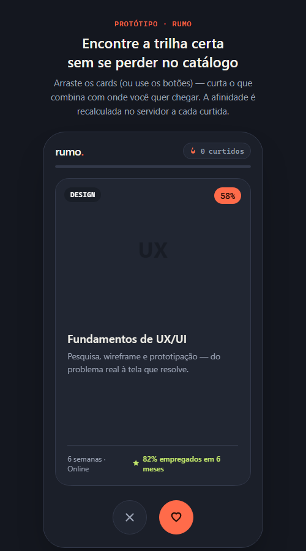
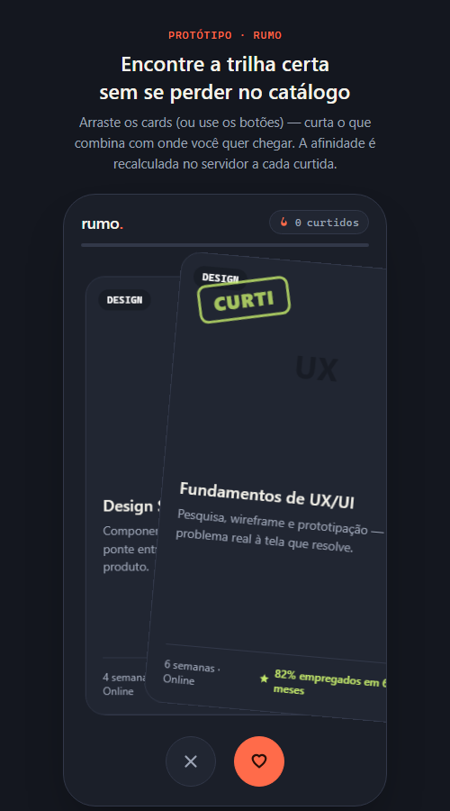
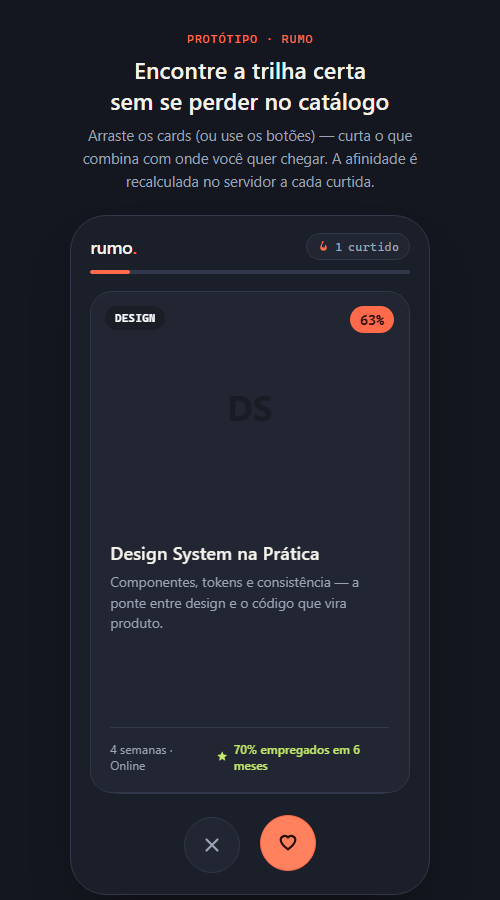
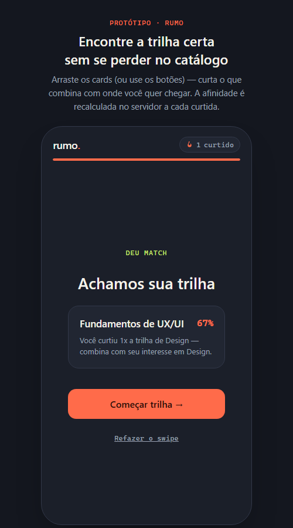

# Do prompt ao protótipo: como o Rumo foi criado

> Este documento explica o processo inteiro de criação do [Rumo](README.md) — desde a ideia até o código rodando — pensado pra quem está aprendendo a programar. Se você já manja de back-end/front-end, pode pular direto pra seção "Da tela ao código".

## 1. De onde veio a ideia

A ideia nasceu num workshop sobre usar IA para gerar protótipos no Figma. O aprendizado principal não foi a ferramenta de IA em si — foi perceber que **o prompt que gera um bom protótipo não nasce pronto: ele nasce de um briefing bem feito.**

Antes de escrever qualquer prompt, o grupo organizou três camadas de informação:

1. **Concorrentes** — quem já tenta resolver o mesmo problema, e como.
2. **Personas** — pessoas reais (ou realistas) com dores específicas, não um "usuário genérico".
3. **Funcionalidades** — uma lista de recursos que respondem, um a um, às dores dessas personas.

Só depois dessas três camadas prontas é que o briefing vira prompt. É a diferença entre pedir pra IA "crie uma plataforma de cursos" (gera algo genérico) e pedir pra resolver um problema específico de uma pessoa específica (gera algo com intenção).

**Se você está aprendendo a programar:** isso vale mesmo sem IA nenhuma. Antes de abrir o editor de código, vale a pena responder: *quem* vai usar isso, *qual problema exato* essa pessoa tem, e *o que* na tela resolve esse problema. Programar sem essas respostas é decorar sintaxe sem saber pra que serve.

## 2. O problema escolhido

A persona imaginada: alguém que terminou uma faculdade (ex.: Publicidade) e quer migrar pra tecnologia, mas trava diante de um catálogo gigante de cursos (Design, Produto, Dados, Marketing...) sem saber por onde começar. Essa "paralisia por excesso de escolha" é a dor central.

A resposta de produto: em vez de um formulário longo perguntando "quais são seus objetivos", a pessoa só reage — curte ou pula cursos, como num app de relacionamento — e o sistema aprende com isso.


*A pessoa vê um card por vez: trilha (Design, Produto...), afinidade (quanto esse curso combina com ela agora) e um selo de empregabilidade.*

## 3. Da ideia ao protótipo visual

Com o briefing pronto, o próximo passo foi um protótipo **sem nenhum código de verdade** — só HTML/CSS/JavaScript simulando a interação, pra testar se a ideia "parecia certa" antes de construir o back-end. Isso é uma prática comum: validar a interface antes de investir tempo no banco de dados e nas regras de negócio.


*Arrastar o card pra direita mostra o selo "CURTI" — feedback visual imediato de que a ação foi reconhecida.*

## 4. Da tela ao código

Depois que a interação "parecia certa", veio a pergunta que todo projeto de verdade precisa responder: **o que esse protótipo precisa saber, e onde isso fica guardado?**

### Front-end vs. back-end (pra quem está começando)

- **Front-end** é tudo que roda no navegador da pessoa: o HTML (estrutura da página), o CSS (aparência) e o JavaScript que reage a cliques e arrastões. O front-end do Rumo não guarda nenhum dado — ele só *pergunta* pro back-end e *mostra* a resposta.
- **Back-end** é o programa que roda no servidor (aqui, um processo Node.js), que guarda os dados de verdade e decide as regras. O Rumo usa [Express](https://expressjs.com/) pra isso — uma biblioteca que facilita responder pedidos HTTP (tipo "me dá a lista de cursos") com código JavaScript.
- Os dois conversam por uma **API**: um conjunto de endereços que o front-end chama (ex.: `GET /api/deck` = "me dá o baralho de cursos") e o back-end responde em JSON (um formato de texto que representa listas e objetos).

### Por que um banco de dados SQL

Sem banco de dados, cada vez que a página recarrega, o sistema "esquece" tudo. O Rumo guarda em [SQLite](https://www.sqlite.org/) (através de uma biblioteca chamada `sql.js`, que roda sem precisar instalar nada no sistema operacional) duas tabelas:

```sql
-- o catálogo de cursos (fixo)
CREATE TABLE cursos (
  id INTEGER PRIMARY KEY AUTOINCREMENT,
  titulo TEXT NOT NULL,
  trilha TEXT NOT NULL,
  afinidade_base INTEGER NOT NULL
  -- ...
);

-- cada decisão da pessoa (cresce com o uso)
CREATE TABLE swipes (
  id INTEGER PRIMARY KEY AUTOINCREMENT,
  curso_id INTEGER NOT NULL,
  decisao TEXT NOT NULL CHECK (decisao IN ('like', 'pass')),
  criado_em TEXT NOT NULL
);
```

`cursos` é o catálogo — não muda sozinho. `swipes` é o histórico — uma linha nova cada vez que alguém curte ou pula um curso. É esse histórico que torna o sistema "inteligente" sem nenhuma IA de verdade rodando: é só uma consulta SQL bem pensada.

## 5. A regra de negócio: afinidade que reage

Aqui está o coração do projeto. A afinidade de um curso **não é um número fixo guardado no banco** — ela é calculada toda vez que o baralho é pedido, somando um bônus por curtida já dada na mesma trilha:

```js
function calcularAfinidade(curso, curtidasPorTrilha) {
  const curtidas = curtidasPorTrilha[curso.trilha] || 0;
  const bonus = Math.min(curtidas * 9, 35); // cada curtida na trilha soma 9%, até um teto
  return Math.min(curso.afinidade_base + bonus, 97);
}
```

Na prática: curtir um curso de Design faz o *próximo* curso de Design aparecer com afinidade mais alta. A tela não muda — o número que ela mostra é recalculado no servidor a cada chamada.


*Depois de curtir dois cursos de Design, o badge de afinidade do card seguinte já reflete isso.*

**Por que isso importa pra quem está aprendendo:** é fácil confundir "parece inteligente" com "é inteligente". Aqui não tem machine learning, não tem IA rodando em produção — é uma soma com um teto, guardada numa tabela SQL. Programas simples, bem pensados pra regra certa, já resolvem a maior parte dos problemas reais.

## 6. O resultado final

No fim do baralho, o back-end escolhe a recomendação final olhando pra qual trilha a pessoa mais curtiu, e monta uma frase explicando o porquê — nunca "porque sim".


*"Você curtiu 2x a trilha de Design" é montado dinamicamente, não é um texto fixo — o servidor sabe disso porque consultou a tabela `swipes`.*

## 7. Resumo do caminho

```
briefing (concorrentes + personas + dores)
  → prompt pra gerar a interface
  → protótipo visual (sem banco, só pra validar a interação)
  → decisão de arquitetura (front-end + back-end + API)
  → banco de dados (o que precisa ser lembrado?)
  → regra de negócio (o que faz o sistema parecer "esperto"?)
  → protótipo funcionando de ponta a ponta
```

Nenhum desses passos exige saber tudo de uma vez. O código completo está no [README do Rumo](README.md) — dá pra ler o `server/regras-negocio.js` de verdade e comparar com a explicação acima.
